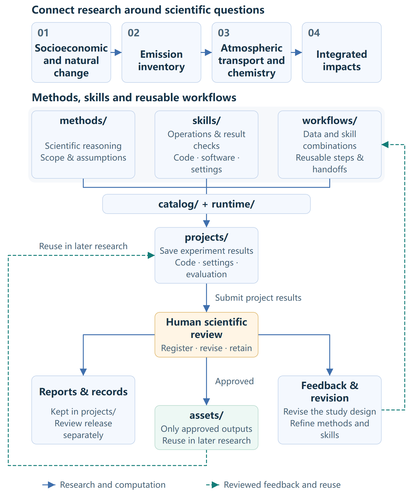

# AirMosaic AI / 清空智枢

An atmospheric-environment research agent built around scientific questions, reusable methods, data and computer-operation skills.

<!-- README-I18N:START -->

**English** | [中文](README_ZH.md)

<!-- README-I18N:END -->

## Research scope

AirMosaic connects changes in human activity and the natural environment with emissions, atmospheric concentrations and their impacts. Its goal is to help researchers investigate pollution causes and evaluate impacts through a research architecture that improves with reviewed evidence. A study can focus on one part of this chain or connect several, referencing existing data and methods.

| Research area | Key coverage | Methods |
|---|---|---|
| 01 Socioeconomic and Natural Change | Activity, population, energy, technology, land use, meteorology and natural drivers | [Methods guide](methods/01_socioeconomic_natural_change/README.md) |
| 02 Emission Inventory | Accounting boundaries, activity/technology-to-emission methods, control efficiency and allocation | [Methods guide](methods/02_emission_inventory/README.md) |
| 03 Atmospheric Transport and Chemistry | Atmospheric inputs and processes, concentration simulation, observations and evaluation | [Methods guide](methods/03_atmospheric_transport/README.md) |
| 04 Integrated Impacts | Health, economic, distributional, ecological, agricultural and climate impacts | [Methods guide](methods/04_integrated_impacts/README.md) |

Select and combine methods around the scientific question. For example, input–output analysis can describe changes in production and consumption, while emission accounting and atmospheric process modelling can assess their effects on pollution concentrations, health, the economy and ecosystems. Connecting methods requires explicit inputs and outputs, scientific assumptions, spatial and temporal scales, and conditions of applicability. Retain the associated uncertainty so researchers can judge whether the results support the study's conclusions.

## How the parts work together

`methods/` explains why a method is appropriate and what it can establish. `skills/` describes how a computer uses the required code or software and checks its outputs. Researchers define a question in `projects/`; an agent uses relevant methods, authorized data and available skills to organize experiments, keeping code, configuration, results and evaluation with that project. `workflows/` provides reusable combinations of those steps. `assets/` manages research inputs and data products registered after human review.



The main sequence is `projects/` (retaining experimental results and evaluation) → human scientific review → `assets/` (selected approved outputs only). Reports and review records stay with the project. Revisions feed back into projects and workflows; unapproved results do not enter the asset library. Internal asset organization will be defined later.

| Directory | Purpose |
|---|---|
| [methods/](methods/README.md) | Human-readable disciplinary background, core questions, method choices, assumptions, quality and interpretation |
| [skills/](skills/README.md) | Computer-operable code/software instructions, dependencies, configuration, invocation and result checks; acquisition and model operations share the research-stage navigation |
| [workflows/](workflows/README.md) | Reusable data-and-skill combinations, handoff contracts and verified examples; retain the conditions under which a sequence can be reused |
| [projects/](projects/README.md) | Scientific questions, study designs, experimental code, configuration, results, evaluation and review records; reference shared methods, skills and data |
| [assets/](assets/README.md) | Storage and reuse of reviewed outputs; internal organization will be defined later |
| [catalog/](catalog/) | Capability declarations; `catalog/tools/` is the executable-tool registration source used for discovery and prerequisites |
| [runtime/](runtime/) | Shared runtime services, CLI and MCP; registered operations reuse one catalog and runner |
| [config/examples/](config/examples/README.md) | Non-secret parameter and path examples; actual personal settings and credentials remain outside the repository |
| [harness/](harness/README.md) | Collaboration and agent boundaries, installation, storage, execution records and checks in `harness/checks/` |

The [layout guide](harness/project-layout.md) describes the installed layout. Local environment, package-metadata and cache folders are generated artifacts, not additional scientific layers. [methods/index.yaml](methods/index.yaml) maintains detailed method-to-skill references; the overview does not duplicate a changing capability inventory.

## From a study to reusable evidence

1. **Define and plan.** The researcher states the scientific question, intended use and acceptance criteria. The agent prepares a plan from the relevant method, data contract and actual skill capabilities, retaining unresolved assumptions for review.
2. **Acquire, compute and evaluate.** Within the approved scope, use available acquisition and model operations, check each handoff and preserve the actual code, settings, input versions, results and evaluation with the project. Missing implementations or scientific prerequisites require explicit adaptation rather than an invented tool call.
3. **Review and improve.** Human review assesses the core results, limitations and approved uses. Feedback can revise the experiment and improve its reusable workflow. General computer operations belong in skills; scientific reasoning belongs in methods.
4. **Reuse selected outputs.** Human scientific review determines which outputs may enter `assets/` for later research. Keep original experimental results and review records with the project. Reports remain with the project; publication is a separate decision. Internal asset organization is outside this revision.

For example, a reviewed pollution-prediction project can yield a reusable sequence for matching observations and gridded inputs, building models and evaluating held-out predictions. The workflow captures the shared procedure; each new project still decides its target, variables, validation and scientific scope. A successful run alone does not qualify a workflow or data product for every study.

Current CLI/MCP discovery and registered execution are implemented through the shared catalog and runner. General autonomous research planning, arbitrary cross-tool orchestration, automatic workflow extraction, scientific approval and data promotion are not implemented services. An agent can guide the documented steps and use supported interfaces, but a workflow description or project manifest does not execute itself. Data registration currently follows the manual [review-and-reuse process](harness/assets.md).

## Start a task

1. Locate the relevant research area and read its methods, including their assumptions and applicability.
2. Find the corresponding operation through [skill navigation](skills/README.md), then read its inputs, configuration, invocation, current readiness and result checks.
3. Use a workflow as a reference and a project to define the study's data, plan, budget, evaluation and output destination; obtain the required review before execution.

Capabilities evolve. Use [category navigation](skills/README.md) and [tool queries](harness/usage/tool-registry.md) for the current entries and dependencies, rather than a fixed capability list in this README:

```sh
python -m pip install -e '.[dev]'
python -m runtime.cli list-tools --format json
```

For setup, see [installation and core usage](harness/usage/core.md), [configuration examples](config/examples/README.md), [run-tool](harness/usage/run-tool.md) and [MCP connection](harness/usage/mcp.md).

## Data, collaboration and contribution

Experimental artifacts belong under `projects/<number_topic>/results/`, following the [project convention](projects/README.md); each task chooses its internal layout. Private project results stay outside Git, and local repository result directories are Git-ignored. Human review separately determines inclusion in `assets/` and public release. Personal configuration and credentials remain separate under the [storage contract](harness/storage-and-credentials.md).

Current runners still use their existing external project-result paths; adapter support for the new project-result path is not implemented. Do not pass that new path to an unsupported interface. Files in compatibility locations remain project experiment records, and successful storage does not mean asset registration. See the [result and review contract](harness/assets.md); this documentation change does not migrate historical results.

Agents follow [AGENTS.md](AGENTS.md). Contributors use the [skill-authoring guide](harness/skill-authoring.md) and [registration guide](harness/tool-registration.md). Detailed method/skill relationships are maintained in [methods/index.yaml](methods/index.yaml), and executable registrations in `catalog/tools/`; routine entry updates do not require expanding this overview.

## License

Apache-2.0; see [LICENSE](LICENSE).
