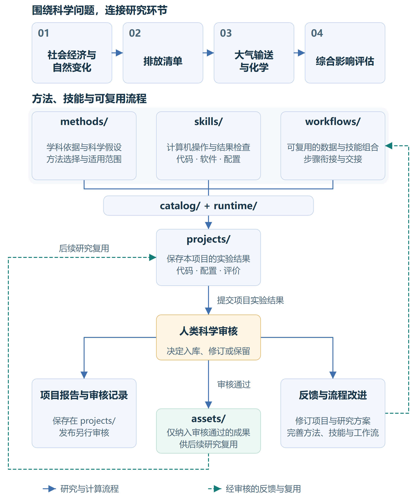

# AirMosaic AI / 清空智枢

围绕科学问题，以可复用的方法、数据和计算机操作技能协助大气环境研究的智能体。

<!-- README-I18N:START -->

[English](README.md) | **中文**

<!-- README-I18N:END -->

## 研究覆盖范围

AirMosaic 将人类活动与自然环境的变化，同排放、大气浓度及其影响联系起来，目标是通过持续吸收经审核证据的研究架构，协助研究者开展污染成因分析与影响评估。具体研究可以围绕一个环节展开，也可以串联多个环节，通过引用复用已有数据和方法。

| 研究环节         | 关键覆盖范围                    | 方法入口                                                        |
| ------------ | ------------------------- | ----------------------------------------------------------- |
| 01 社会经济与自然变化 | 活动、人口、能源、技术、土地利用、气象和自然驱动  | [方法说明](methods/01_socioeconomic_natural_change/README_ZH.md) |
| 02 排放清单      | 核算边界、活动与技术转为排放的方法、治理效率和分配 | [方法说明](methods/02_emission_inventory/README_ZH.md)           |
| 03 大气输送与化学   | 大气输入和过程、浓度模拟、观测与评估        | [方法说明](methods/03_atmospheric_transport/README_ZH.md)        |
| 04 综合影响评估    | 健康、经济、分配、生态、农业和气候影响       | [方法说明](methods/04_integrated_impacts/README_ZH.md)           |

根据科学问题选择和组合方法：例如，通过投入产出分析研究生产与消费变化，再结合排放核算和大气过程模拟，评估这些变化对污染浓度及健康、经济和生态的影响。方法衔接时，需明确各环节的输入输出、科学假设、时空尺度和适用范围，并保留相应的不确定性，供研究者判断结果是否能够支持研究结论。

## 各部分如何协作

`methods/` 解释为什么采用一种方法，以及它能回答什么；`skills/` 说明计算机怎样使用相应代码或软件，并检查输出。研究者在 `projects/` 定义问题，智能体结合有关方法、获授权数据和已有技能组织实验，将代码、配置、实验结果与评价保存在对应项目中。`workflows/` 提供可复用的步骤组合；`assets/` 管理研究输入及经人类审核后入库的数据产品。



图中主线为 `projects/`（保存实验结果与评价）→ 人类科学审核 → `assets/`（仅纳入审核通过的选定成果）。报告与审核记录保留在项目中，需要修订时反馈给项目与工作流；未获批准的结果不入库。资产内部组织方式留待后续确定。

| 目录                                               | 用途                                            |
| ------------------------------------------------ | --------------------------------------------- |
| [methods/](methods/README_ZH.md)                 | 面向人类的学科背景、核心问题、方法选择、假设、质量与结果解释                |
| [skills/](skills/README_ZH.md)                   | 计算机可操作的代码/软件说明、依赖、配置、调用及结果检查；数据获取与模型操作共用研究阶段导航 |
| [workflows/](workflows/README_ZH.md)             | 可复用的数据与技能组合、交接契约和经过验证的示例，保留复用条件               |
| [projects/](projects/README_ZH.md)               | 具体科学问题、研究设计、实验代码、配置、结果、评价和审核记录；引用共享方法、技能与数据 |
| [assets/](assets/README_ZH.md)                   | 经审核成果的保存与复用入口；内部组织方式后续完善 |
| [catalog/](catalog/)                             | 能力声明；`catalog/tools/` 是可执行工具注册来源，供发现及前提检查使用   |
| [runtime/](runtime/)         | 公共运行服务、CLI 与 MCP；已注册操作共用一套能力目录和执行器              |
| [config/examples/](config/examples/README_ZH.md) | 公用参数与路径示例；实际个人设置及凭据保留在仓库外                     |
| [harness/](harness/README_ZH.md)                 | 协作与代理边界、安装、存储、执行记录及 `harness/checks/` 中的检查    |

安装后的布局见[布局说明](harness/project-layout_ZH.md)。本地环境、包元数据与缓存目录是生成产物，不是额外的科学层级。[methods/index.yaml](methods/index.yaml)维护详细的方法与技能引用，总览不重复维护持续变化的能力清单。

## 从研究到可复用证据

1. **定义与规划。** 研究者提出科学问题、预期用途和验收条件，智能体根据相关方法、数据契约与实际技能能力准备方案，将未决假设保留供审核。
2. **获取、计算与评价。** 在获准范围内使用已有的数据获取和模型操作，检查各次交接，在对应项目中保存实际代码、设置、输入版本、结果及评价。缺少实现或科学前提时明确适配需求，不虚构工具调用。
3. **审核与改进。** 人类审核核心结果、限制与获准用途，反馈可以修订实验并优化其可复用工作流。通用计算机操作归技能，科学依据归方法。
4. **复用选定成果。** 人类根据科学审核决定哪些成果可纳入 `assets/`，供后续研究复用；项目保留原始实验结果与审核记录。报告留在项目中，发布另行决定。本轮不规定资产内部的组织方式。

例如，经过审核的污染预测项目，可以提炼出观测与网格输入匹配、模型构建及留出预测评价的可复用流程。工作流保留共用过程，新项目仍需决定目标、变量、验证和科学范围。一次运行成功不代表工作流或数据产品适合所有研究。

当前 CLI/MCP 的发现与已注册执行能力通过共用目录和执行器实现。通用自主研究设计、任意跨工具编排、自动提炼工作流、科学审批和数据入库尚未实现为服务。智能体可以引导文档规定的步骤并调用已支持接口，但工作流说明或项目清单不会自行执行。数据登记目前遵循人工[审核与复用流程](harness/assets_ZH.md)。

## 开始一个任务

1. 找到相关研究环节，阅读有关方法、假设和适用范围。
2. 通过[技能导航](skills/README_ZH.md)选择操作，阅读输入、配置、调用、当前可用状态和结果检查。
3. 以工作流为参考，在项目中明确数据、方案、预算、评估及输出位置，执行前完成必要审核。

具体能力会持续变化，通过[分类导航](skills/README_ZH.md)和[工具查询](harness/usage/tool-registry.md)查看当前入口与依赖，项目README 不维护固定能力清单：

```sh
python -m pip install -e '.[dev]'
python -m runtime.cli list-tools --format json
```

环境准备见[安装与基础用法](harness/usage/core.md)、[配置示例](config/examples/README_ZH.md)、[run-tool](harness/usage/run-tool.md)和 [MCP 连接](harness/usage/mcp_ZH.md)。

## 数据、协作与贡献

实验产物按[项目约定](projects/README_ZH.md)归入 `projects/<number_topic>/results/`，内部布局由任务选择。私人项目结果保留在 Git 外；仓库中的本地结果目录被 Git 忽略。是否纳入 `assets/` 与是否公开发布分别由人类审核决定。个人配置和凭据继续按[存储规范](harness/storage-and-credentials_ZH.md)分离。

当前执行器仍使用原有外部项目结果路径，新项目结果路径的执行器适配尚未实现；不得直接把新目录传给不支持的接口。兼容目录中的文件仍属于项目实验记录，保存成功不表示已经入库。详见[结果与审核约定](harness/assets_ZH.md)，本次说明调整不迁移历史结果。

代理遵循 [AGENTS.md](AGENTS_ZH.md)。贡献者阅读[技能编写](harness/skill-authoring_ZH.md)与[注册规范](harness/tool-registration_ZH.md)。详细方法与技能关系由 [methods/index.yaml](methods/index.yaml) 维护，可执行登记由 `catalog/tools/` 维护；常规入口更新不要求扩充本总览。

## 许可证

Apache-2.0，见 [LICENSE](LICENSE)。
