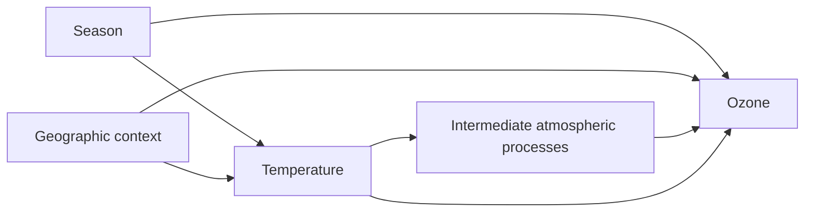

# Applying regression to air-pollution questions

**English** | [中文](air_pollution_regression_ZH.md)

Air-pollution research connects drivers, emissions, atmospheric transport and chemistry, concentration, exposure and impacts. Locate the question on this chain before choosing a model. This guide illustrates the [general regression method](machine_learning_model/README.md); configuration belongs to the [skill cases](../../skills/model/shared/machine_learning_model/references/air-pollution.md).

## Case 1: Predict PM2.5 concentration

Suppose the question is “How accurately can daily mean PM2.5 be estimated in unmonitored areas?” Define the grid or other spatial support, period and concentration unit of the prediction field. Monitored site-days supply training labels and independent evaluation references; they do not provide observations everywhere in the prediction domain.

First build a compatible table. The concentration and meteorological measurements must refer to the intended place, time zone and averaging period. Apply source-specific coverage rules, record station changes and missingness, and verify spatial matching. The [station preparation method](../03_atmospheric_transport/pm25_stations_preparation.md) explains these decisions for the relevant sources.

Choose candidate variables according to what the model will know. Possible families include:

| Family | Why consider it? | A decision to explain |
|---|---|---|
| Meteorology | Describe weather conditions associated with concentration | Is realized weather available for retrospective analysis, or is a forecast needed? |
| Geography and land surface | Describe differences between sites | Will the learned relationships transfer to the intended new sites? |
| Calendar and time | Describe seasonal or longer-term patterns | Does the target application include future periods outside the development range? |
| Available composition/background information | Add atmospheric context | Is the measurement available and sufficiently independent of the target's construction? |

This is a candidate menu, not a fixed predictor set. Select scientifically interpretable variables with usable measurements. Examine redundancy within training data and record exclusions.

### Decide separately whether coordinates belong in the model

[Meyer et al. (2019), *Importance of spatial predictor variable selection in machine learning applications*](https://arxiv.org/abs/1908.07805), show that highly spatially autocorrelated predictors, including coordinates, can reproduce sampled locations while generalizing poorly and producing map artefacts. Variable selection must therefore assess spatial prediction, not only training fit or random validation.

[Milà et al. (2024), *Random forests with spatial proxies for environmental modelling: opportunities and pitfalls*](https://gmd.copernicus.org/articles/17/6007/2024/), identify important conditions: proxies helped interpolation with well-spread samples and strong residual spatial autocorrelation, but were unsuitable for new-area transfer in their experiments; clustered sampling was particularly problematic. This supports a conditional decision, not a universal ban on coordinates.

For a new regional study, this project's recommended starting comparison is:

| Candidate | What it tests | Basis for a decision |
|---|---|---|
| Environmental variables without coordinates | Whether measured/modelled environmental information can support the target | Physical meaning, product independence and intended-holdout performance |
| The same variables plus coordinates | Whether location adds transferable predictive information | Compare on the same development samples and spatial validation design; check improvement across groups, not just a pooled score |
| Coordinates alone, as a diagnostic | Whether location can largely identify the sampling pattern | Similar performance is a warning to investigate location dependence, not proof of a physical mechanism |

Keep coordinates in the sample metadata for grouping, distance checks and mapping even when excluding them from predictors. Apply any learned variable selection inside development folds and reserve the final test. Correlation/VIF screening alone cannot establish spatial transferability, and removing coordinates alone cannot eliminate dependence encoded by other geographic variables.

Before accepting a regional map, inspect block-like or strip-like boundaries, their alignment with coordinate splits and input-product boundaries, residual patterns and unsupported predictor combinations. Standard tree partitions, discontinuous inputs and sparse coverage are alternative explanations; a block is a diagnostic observation, not proof that coordinates caused it. Do not smooth a map merely to conceal the pattern.

For causal questions, select adjustment variables from the study-specific graph and identification argument. A location proxy's predictive value does not establish a causal effect, and a predictive-variable exclusion rule must not automatically remove a necessary confounding adjustment.

For reanalysis, fused concentration or simulated predictors, apply the [product-lineage checks](machine_learning_model/README.md). Determine whether the selected variable/version incorporates ground concentration observations, including the evaluation stations and periods. Do not assume every reanalysis variable assimilates the target pollutant, or that all products are independent because they have different providers. A product built from held-out monitors can compromise the claimed independence of regional evaluation. Review release times for forecasting and use an independent reference or a documented sensitivity comparison where appropriate.

Because the goal concerns unmonitored areas, reserve sites or regions for the final evaluation. A random split of site-days can share each site's characteristics across development and test samples. The [official resampling guide](https://mlr3spatiotempcv.mlr-org.com/) explains why validation should match deployment.

Compare a mean baseline and a few candidates. Assess errors by site, season and concentration range when those distinctions matter. Explain the fitted model using predictive importance and response plots, keeping the data support and reference conditions visible.

The current runner trains and evaluates a labelled table. Applying the saved model to a separate unlabelled regional input and exporting a concentration field still needs a reviewed inference/export adaptation; the configured target alone does not implement that step.

For long-term ozone, [Betancourt et al. (2022)](https://gmd.copernicus.org/articles/15/4331/2022/) used absolute latitude as a proxy and suggested temperature/radiation inputs as an improvement. This is a task-specific precedent, not evidence that signed latitude, absolute latitude or a fixed land-use list suits every pollutant. Match the physical variables' period and support to the outcome before proposing them. The candidate comparisons, spatial resampling and map diagnostics above are study requirements to implement and review, not additional capabilities automatically supplied by this runner.

## Case 2: Study temperature and ozone

“Does temperature help predict ozone?” uses the predictive design above. “How would ozone change under a defined temperature contrast?” additionally requires causal identification.

Define the outcome statistic, temperature contrast, period and target population. Then draw a study-specific causal graph. A teaching example is:

The graph illustrates possible confounding by season/geographic context and a mediated path. It is not a complete atmospheric mechanism. Investigate additional common causes, measurement processes and unobserved factors in the actual study. Simple season or location descriptors may not control the relevant confounding.

Specify the physical meaning of each variable: near-surface air temperature differs from satellite land-surface temperature, and a grid-cell concentration estimate differs from a site measurement. Establish whether a proxy supports the proposed temperature contrast. Record evidence for the main causal directions, plausible alternatives and sensitivity to product choice or measurement error, especially when predictors and outcomes share source observations.

If the goal is a total effect, preserve the intermediate path when defining adjustment. Do not choose adjustment variables from a feature-importance ranking. Establish that treatment, outcome and covariates have a defensible temporal order, sufficient overlap and a suitable dependence structure.

A partially linear effect is one possible model when its assumptions fit. Cross-fitting helps separate auxiliary-model fitting from effect estimation; it does not resolve unmeasured confounding. Repeated station observations may require group-aware estimation, while regional transport can leave dependence between groups. State the reporting contrast and uncertainty sources explicitly.

For interpretation, write “estimated outcome change per specified temperature increment under the stated design.” A nonlinear response curve, a different intervention or an effect varying across regions needs its own estimator and validation.

## Case 3: Examine a trend after accounting for weather

Suppose annual concentrations decline, and the question is how the trend looks under comparable meteorological conditions. Meteorological normalization averages predictions over a defined weather reference distribution; the resulting time series then needs a trend analysis.

Decide which weather variables vary, how their joint distribution is represented and which reference period is used. Assess sensitivity to these choices and account for uncertainty. [Grange et al. (2018)](https://acp.copernicus.org/articles/18/6223/2018/) provide a primary PM10 example.

A response plot is not the normalization calculation. Interpreting the remaining trend also requires considering changes in observations and other relevant drivers. The current regression adapter provides the predictive model; this reference-distribution and trend operation remains a separate adaptation.

## Case 4: Study downstream impacts

For a question about human or natural impacts, first explain how concentration becomes the relevant exposure. Define the population or ecological unit, time window, outcome and denominator. A concentration at a monitor may not represent the exposure assigned to every unit.

A numeric impact outcome can support prediction when the sample design and measurement are appropriate. Estimating an exposure effect additionally needs a causal design; estimating attributable burden needs a suitable response relationship, baseline and population definition. Time lags, nonlinear response and uncertainty should follow the specific question.

The current regression skill supports numeric prediction and the declared continuous-treatment partially linear effect. Dedicated count/binary/survival models, distributed lags, validated exposure-response functions and burden calculations require specialist implementations.

## How to choose parameters in these examples

Separate three decisions:

1. **Scientific design:** averaging period, time lag, predictor availability, adjustment, target population and sample split. These define the question.
2. **Model fitting:** node size, depth and candidate variables per split control the fit; tree count primarily controls ensemble stability. Choose them using development data and error patterns.
3. **Computation:** sample caps, candidate count, threads and explanation sample size. These control cost and the precision of numerical approximations.

Use the [literature-based parameter guide](machine_learning_model/README.md) to translate the actual data conditions into a small explicit candidate set. For sparse or clustered monitoring, prioritize spatial coverage and validation; for dense repeated site-days, distinguish row count from independent sites and periods. For a long-term mean, justify averaging and static proxies; for forecasting, justify lags and issue-time availability. These scientific choices cannot be settled by increasing tree count or deepening the forest.

Choose candidates on validation data and freeze the test comparison. Present each variable's reason and each parameter range, supporting source, data-specific rationale, alternatives and uncertainty in the [model plan](model_planning.md) before generating experiment code. Keep sample coverage, variable roles, actual cohort and residual patterns with the result. Exact code and configuration steps are in [the air-pollution skill reference](../../skills/model/shared/machine_learning_model/references/air-pollution.md).
