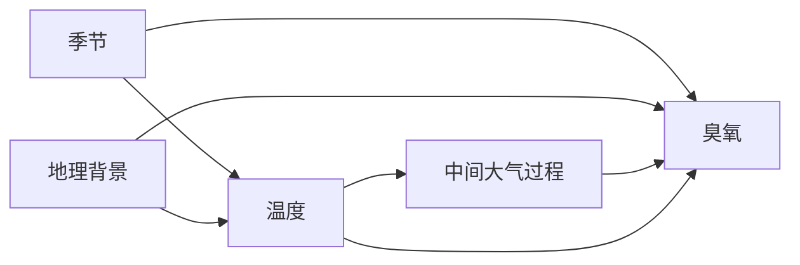

# 如何将回归用于空气污染问题

[English](air_pollution_regression.md) | **中文**

空气污染研究连接驱动因素、排放、大气输送与化学、浓度、暴露和影响。先确定问题位于哪一段，再选择模型。下面用具体问题说明[通用回归方法](machine_learning_model/README_ZH.md)的应用，配置操作见[技能特例](../../skills/model/shared/machine_learning_model/references/air-pollution_ZH.md)。

## 特例一：预测 PM2.5 浓度

假设问题是“未布站区域的日均 PM2.5 能估计得多准确？”先定义预测场的网格或其他空间尺度、时期及浓度单位。已有站点日观测提供训练标签和独立评估参照，不代表预测区域各处都有观测。

先形成口径一致的数据表。浓度和气象需要对应预期地点、时区与平均时期。采用来源规定的完整性规则，记录站点变化和缺失，核对空间匹配。有关来源的具体决策见[站点整理方法](../03_atmospheric_transport/pm25_stations_preparation_ZH.md)。

按模型实际能够获得的信息选择变量，可考虑：

| 类别 | 为什么考虑 | 需要解释的决策 |
|---|---|---|
| 气象 | 描述与浓度有关的天气条件 | 是回顾分析可用的实测天气，还是需要预报产品？ |
| 地理与地表 | 描述站点间差异 | 学到的关系能否迁移到预期的新站点？ |
| 日历与时间 | 描述季节和长期变化 | 用途是否涉及开发数据范围之外的未来时期？ |
| 可获得的成分或背景信息 | 提供大气背景 | 数据是否可用，与目标构造是否足够独立？ |

这是候选类别，不是固定特征集合。选择科学含义明确、测量可用的变量，在训练数据内检查冗余并记录排除原因。

### 单独判断是否纳入经纬度

[Meyer 等（2019），《机器学习应用中空间预测变量选择的重要性》](https://arxiv.org/abs/1908.07805)指出，包括坐标在内的强空间自相关变量，可能使模型复现采样地点，却难以迁移并产生地图伪影。因此，变量筛选应评估空间预测能力，不能只看训练拟合或随机验证。

[Milà 等（2024），《环境建模中使用空间代理变量的随机森林：机会与陷阱》](https://gmd.copernicus.org/articles/17/6007/2024/)进一步区分条件：其研究中，采样分布充分、残差空间自相关较强时，代理变量可改善区域内插值；新区域迁移并不适合，聚集采样尤其需要谨慎。这支持按条件决定，不能据此一概禁止坐标。

针对新的区域研究，本项目建议先设计以下比较：

| 候选 | 检查什么 | 判断依据 |
|---|---|---|
| 环境变量，不含坐标 | 实测或模拟环境信息能否支持目标 | 物理含义、产品独立性及预期用途的留出表现 |
| 相同环境变量，加坐标 | 位置是否增加可迁移的预测信息 | 在相同开发样本与空间验证设计下比较，检查各组改善，不能只看汇总分数 |
| 仅坐标，作为诊断 | 位置是否足以识别采样格局 | 表现相近时应调查位置依赖，不能将其当成物理机制证据 |

即使不作为特征，坐标仍保留在样本元数据中，供分组、距离核对和制图使用。学习型变量筛选在各开发训练折内完成，最终测试单独保留。相关性或 VIF 筛选不能证明空间可迁移性，删除坐标也不能消除其他地理变量编码的依赖。

区域地图验收前，检查块状或条带边界，核对其与坐标分裂、输入产品边界的对应关系，并检查残差格局及缺乏支持的特征组合。普通树分区、输入不连续和覆盖稀疏都是可能解释；块状现象属于诊断观察，不能直接证明由坐标造成，也不能仅通过平滑掩盖它。

因果问题仍按研究专用因果图与识别论证选择调整变量。位置代理的预测价值不能证明因果效应，预测变量的排除规则也不能自动删除必要的混杂调整项。

再分析、融合浓度或模拟特征按[产品来源检查](machine_learning_model/README_ZH.md)逐项核对：所选变量及版本是否纳入地面浓度观测，是否包括评估站点和时期。不能假定所有再分析变量都同化目标污染物，也不能因提供方不同就认定相互独立。产品若已使用留出监测站，区域评估的独立性可能受到影响。预报还需核对发布时间，必要时采用独立参照或明确的敏感性比较。

因为目标是未布站区域，最终评估应留出站点或区域。随机拆分站点日，可能使同一站点的特点同时出现在开发与测试样本中。官方[重抽样说明](https://mlr3spatiotempcv.mlr-org.com/)解释了验证为什么应与实际用途对应。

比较均值基线与少量候选。问题需要时按站点、季节和浓度范围检查误差。用预测重要性和响应图解释模型，同时说明数据支持范围和参考条件。

当前执行器训练并评估带标签表格。将保存模型用于另一份无标签区域输入、导出浓度场，仍需经审查的推理与导出适配；仅配置目标不会实现这一步。

长期臭氧研究中，[Betancourt 等（2022）](https://gmd.copernicus.org/articles/15/4331/2022/)使用绝对纬度作为代理，并提出加入温度、辐射信息的改进方向。这是特定任务的先例，不能证明原始纬度、绝对纬度或固定土地利用列表适合所有污染物。提出物理变量时，应先匹配其时期、尺度与目标。上述候选比较、空间重抽样和地图诊断需要按研究实现与审查，不能理解为执行器已自动提供这些功能。

## 特例二：研究温度与臭氧

“温度能否帮助预测臭氧”使用前面的预测设计；“在指定温度对比下臭氧如何改变”还需要因果识别。

明确结果统计量、温度对比、时期和目标总体，再画出研究专用因果图。教学示例如下：

图中说明了季节、地理背景可能引入的混杂，以及通过中间过程传递的路径，它并非完整的大气机制。实际研究应调查其他共同原因、测量过程和未观测因素；简单的季节或位置描述未必能控制有关混杂。

逐项明确变量的物理含义：近地面气温与卫星地表温度不同，网格浓度估计与站点实测也不同。判断代理量能否支持所定义的温度对比。为主要因果方向记录依据、合理备选解释，以及产品选择和测量误差的敏感性，尤其关注特征与结果共用来源观测的情况。

研究总效应时，在定义调整集时保留中间路径。不要从特征重要性排名选择调整变量。先论证处理、结果、协变量的时间顺序、足够的重叠性和合适的依赖结构。

部分线性效应是在假设合适时的一种模型选择。交叉拟合有助于分开辅助模型拟合与效应估计，不解决未测混杂。重复站点观测可能需要考虑分组，区域输送仍可能使不同组之间相关。明确报告对比与不确定性来源。

解释时写成“在所声明设计下，每指定温度增量对应的估计结果变化”。非线性响应曲线、其他干预或不同地区的异质效应，需要相应估计方法与验证。

## 特例三：扣除天气差异后观察趋势

假设年均浓度下降，想知道在可比气象条件下趋势如何。气象归一化将预测在指定天气参考分布上平均，然后对形成的时间序列进行趋势分析。

先决定变化哪些气象变量、如何表示其联合分布、采用哪个参考时期，再评估这些选择的敏感性和不确定性。[Grange 等（2018）](https://acp.copernicus.org/articles/18/6223/2018/)提供了 PM10 的一手示例。

响应图没有完成归一化计算。解释剩余趋势还应考虑观测变化和其他有关驱动。当前回归适配器提供预测模型，参考分布运算与趋势分析仍需单独适配。

## 特例四：研究下游影响

研究人类或自然影响，首先说明浓度如何转为有关暴露，明确人口或生态单元、时间窗口、结果与分母。监测站浓度未必能代表分配给每个单元的暴露。

在样本设计和测量合适时，数值影响结果可以用于预测。估计暴露效应还需要因果设计；估算归因负担还需要合适的响应关系、基线和人口定义。滞后、非线性响应及不确定性按具体问题处理。

当前回归技能支持数值预测和已声明的连续处理部分线性效应。专用计数、二元、生存模型，分布滞后，经过验证的暴露响应函数及负担计算，需要相应专业实现。

## 这些例子中如何选参数

把三类决策分开：

1. **科学设计：**平均时期、滞后、变量可用性、调整、目标总体与划分，决定研究问题。
2. **模型拟合：**节点大小、深度与每次分裂的候选变量数控制拟合，树数主要控制集成稳定性；根据开发数据及误差规律选择。
3. **计算安排：**样本上限、候选数、线程和解释样本量，控制计算成本及数值近似精度。

按[有文献依据的参数选择说明](machine_learning_model/README_ZH.md)，将实际数据条件转成少量明确候选。站点稀疏或聚集时，优先解决空间覆盖与验证；站点日记录密集时，区分行数与独立站点、时期数量。长期均值需要论证平均口径与静态代理，预报需要论证滞后及发布时间可用性。这些科学决策不能通过增加树数或加深森林解决。

根据验证数据选型，冻结测试比较。生成实验代码前，在[建模方案](model_planning_ZH.md)中呈现逐变量理由、参数范围、来源、适用于本数据的依据、备选及不确定性。结果同时保留样本覆盖、变量角色、实际队列及残差规律。具体代码和配置步骤见[空气污染技能说明](../../skills/model/shared/machine_learning_model/references/air-pollution_ZH.md)。
