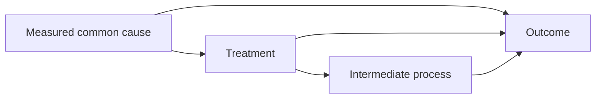

# Causal design and treatment effects

**English** | [中文](causal_ZH.md)

## 7. For causal questions, design the graph and contrast first

A directed acyclic graph records hypothesized causal directions. Let a measured common cause affect both treatment and outcome, and let an intermediate process transmit part of the treatment's effect:

For the total effect in this illustrative graph, the common cause is an adjustment candidate and the intermediate process is part of the effect being studied. The actual graph needs subject knowledge, timing and measurement evidence. Include plausible unmeasured causes; check whether the available observations identify the proposed effect.

For each important arrow, retain a physical mechanism or other evidence and its uncertainty. Consider plausible alternative graphs, measurement error and the observation/product-generation process. Check whether proxy variables represent the proposed intervention and whether spatial transport creates interference. Use sensitivity analyses for unresolved confounding and design choices; statistical fit, graph validity and a causal estimator do not establish that the relationships are true.

The current partially linear approach predicts the outcome and treatment from the adjustment variables, then relates the remaining variation. It fits these auxiliary models on other folds so each observation is evaluated out of fold. This reduces fitting bias under the design; causal ordering, consistency, adequate overlap, confounding control, the effect form and the dependence assumptions still require justification. See the primary [model explanation](https://docs.doubleml.org/stable/guide/models.html) and [cross-fitting guide](https://docs.doubleml.org/stable/guide/resampling.html).

State the treatment contrast in understandable units. A linear effect per temperature increment answers a different question from a nonlinear exposure-response curve or a policy comparison.
