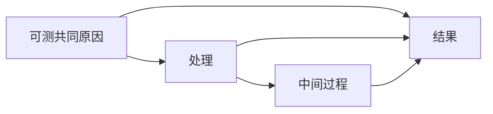

# 因果设计与处理效应

[English](causal.md) | **中文**

## 7. 因果问题先设计图和对比

有向无环图记录假设的因果方向。例如，一个可测共同原因同时影响处理与结果，中间过程传递部分处理作用：

在这一示意图中研究总效应，共同原因是调整候选，中间过程则属于要研究的作用。真实图需要学科知识、时间顺序和测量依据，也应纳入可能的未测共同原因，检查现有观测能否识别所提效应。

为关键箭头保留物理机制或其他依据，并标注不确定性；考虑合理的备选图、测量误差，以及观测和产品生成过程。核对代理量能否代表所研究的干预、区域输送是否引入单元间干扰。对未解决的混杂和设计选择进行敏感性分析；拟合表现、图结构检查和因果估计器都不能证明关系真实。

当前部分线性方法先用调整变量预测结果与处理，再研究剩余变化之间的关系。辅助模型在其他折拟合，使每条观测都由折外模型评估，减少给定设计下的拟合偏差。因果顺序、一致性、足够重叠、混杂控制、效应形式和依赖假设仍需论证。方法依据见一手[模型说明](https://docs.doubleml.org/stable/guide/models.html)与[交叉拟合说明](https://docs.doubleml.org/stable/guide/resampling.html)。

用易理解的单位写出处理对比。每个温度增量对应的线性效应、非线性暴露响应曲线和政策对比，回答的是不同问题。
