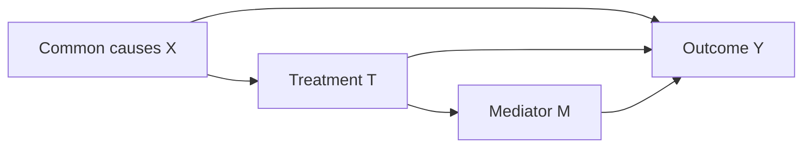

# Data and regression-skill combination

**English** | [中文](README_ZH.md)

This directory provides an agent-guided data/skill recipe with code generation instructions and a tested orchestration example. The executable modules belong to the [regression skill](../../skills/model/shared/machine_learning_model/SKILL.md); scientific definitions belong to [methods](../../methods/shared/machine_learning_model/README.md). A particular research question and its experiments belong to [numbered projects](../../projects/README.md). `workflow.yaml` is a documented recipe, not a general execution engine.

New studies begin with [plan → review → generation → execution](planning.md), using the [plan-aware caller](examples/planned_regression.py). Human review is the default; agent judgment requires explicit user delegation. The fixed synthetic program below remains a legacy technical replay, not evidence of a newly reviewed scientific plan.

## Design the combination

Configure and invoke the skill using its [operation contract](../../skills/model/shared/machine_learning_model/references/operations.md). For air-pollution tasks, follow the [domain method](../../methods/shared/air_pollution_regression.md) and [operational cases](../../skills/model/shared/machine_learning_model/references/air-pollution.md). Reusable numerical operations stay in skills; generated workflow code supplies task settings and orchestration.

1. **Choose data and define the target.** Define the unobserved spatial/time prediction domain separately from observed or proxy training labels. Fix input versions, units, averaging period and prediction-time information. Review predictor lineage, assimilation/fusion/calibration and reuse of evaluation observations; follow the method's independence and availability checks. Data preparation must satisfy the task contract.
2. **Set the interpretation question.** Choose predictive association or a specified causal effect. For a causal question, define treatment, outcome, dose scale and estimand before selecting controls.
3. **Design a DAG.** Define physical quantities and proxies, justify directions with mechanisms/evidence and temporal order, and consider alternative graphs and measurement/product-generation dependencies. Identify common causes, mediators, colliders and unmeasured factors; choose adjustment and sensitivity checks for the estimand. The program checks acyclicity and the supported backdoor condition, not the truth of the graph.
4. **Select the operational branch.** Prediction combines training-only screening, regression, validation-based selection, frozen evaluation and predictive explanations. Causal PLR combines the declared adjustment set, fold-specific nuisance regressions and residual-score estimation. Predictive importance is not an adjustment-set selector.
5. **Inspect handoffs.** Choose study-specific splits from usable data and independent spatial/time units; configure computation caps separately. Check sample keys, variable roles, units, fitted transformations, boundaries and artifacts. Record unknown product dependence; the runner does not verify upstream lineage. Unlabelled regional inference/export remains an adaptation. Failed operational checks stop downstream computation.
6. **Save and review.** Synthetic workflow checks use this workflow's ignored results; other generic demonstrations use the skill's ignored local results; project runs use their external project root with task-defined folders and file names. Scientific review precedes reuse.

## DAG example

The diagram is a generic adaptation of the reasoning illustrated in Figure 2 of the [published article](https://doi.org/10.1016/j.atmosres.2026.108869), not an automatically discovered graph.



For the total effect, `X` may block the backdoor path while `M` is a treatment descendant. Choosing direct effects, a different graph or an observational adjustment set requires a corresponding scientific design. The prediction example does not activate causal estimation.

## Two examples

| Combination | Data | Settings | Purpose |
|---|---|---|---|
| Station-level ozone prediction | External AQ-Bench v1 | [Prediction task](../../config/examples/ml-regression/aq-bench-prediction.json), [runner parameters](../../config/examples/run-tool/aq-bench-ml-regression.json) | Demonstrate target definition, regression and predictive explanation |
| Known-effect causal demonstration | [Synthetic example](../../assets/data/03_atmospheric_transport/SyntheticCausal/v1/README.md) | [Causal task](../../config/examples/ml-regression/synthetic-causal.json), [runner parameters](../../config/examples/run-tool/synthetic-causal.json) | Check a declared DAG and cross-fitted PLR against known slope 2 |

Use the registered tool `ml_regression_workflow` as the operational entry; see the skill for dependencies, preview, parameter validation, output naming and MCP grants. The name is retained as an entry identifier; code no longer depends on executing this recipe YAML.

The [0001 research project](../../projects/0001_ozone_environmental_drivers/README.md) specifies scientific comparisons separately. Generic checks do not complete those experiments. No general multi-experiment orchestration, automatic causal discovery, scientific approval or data promotion is provided.

## Agent request example

> Use the authorized input version and regression skill to predict the configured target from the declared feature list. First check units, sample keys, split labels and prediction-time availability. Use the small example budget, preview through `ml_regression_workflow`, then fit, evaluate and explain. Keep a synthetic workflow check in this workflow's ignored results, or another generic demonstration in the skill's ignored results. For a particular study, use its stable project ID and a task-chosen directory within the project result root. Report the artifact index, metrics and checks. If causal interpretation is requested, first propose the treatment, outcome, estimand, DAG and adjustment assumptions for scientific review; do not derive them from feature importance.

The agent converts this request into supported settings and operations. The recipe does not execute free text, choose arbitrary models or grant new data access. Use the task schema and stop at unsupported requirements with explicit adaptation items.

## Translate a request into supported settings

The [shared design method](../../methods/shared/requirements_driven_model_building.md) defines scientific choices. This recipe maps them to the existing task schema; it does not introduce a separate request loader.

| Request | Existing task setting or handoff | Boundary |
|---|---|---|
| Predict a numeric response | `target`, `target_unit`, `target_definition` | Aggregation, unit conversion and temporal alignment require explicit preparation |
| Use or screen predictors | `features`, `excluded_features`, `feature_selection` | Screening uses training data; causal adjustment remains manual |
| Choose a regression model | Bounded `models` entries supported by the skill | Other learners and automatic tuning require adaptation |
| Set development and evaluation | `id_column`, `split`, `row_limits`, `seeds` | Supply valid labels and an appropriate study split; no automatic spatial split builder |
| Explain fitted predictions | `explanation.methods` and background limits | Use supported predictive explanations and state their scope |
| Estimate the supported causal effect | `analysis: causal_plr` and explicit `causal` settings | Specify DAG, adjustment, nuisance model, folds and scientific assumptions first |
| Save results | Runner project/scope settings and task `output_files` | Preserve provenance and existing artifacts within the selected result boundary |

Read the data contract, select the [prediction](../../config/examples/ml-regression/aq-bench-prediction.json) or [synthetic causal](../../config/examples/ml-regression/synthetic-causal.json) settings, and use the corresponding [runner parameters](../../config/examples/run-tool/aq-bench-ml-regression.json). Preview first, execute within the authorized budget, then check the artifact index, sample keys, frozen-model metrics and interpretation. Preparation, fitting, evaluation and explanation are internal modules of one registered skill entry, not separate tool IDs or an automatically executed YAML chain.

Before each handoff, check field roles, units, sample/split identity, learned transformations and expected artifacts. A failed prerequisite stops dependent operations. Specific experiments and comparison results belong to a project; the [ozone project reference](../../projects/0001_ozone_environmental_drivers/references/air_quality_o3_reference.md) records the legacy case and does not make it a default algorithm or a completed project experiment.

AQ-Bench is also available as a [registered repository snapshot](../../assets/data/03_atmospheric_transport/AQ-Bench/v1/README.md). Use [repository parameters](../../config/examples/run-tool/aq-bench-repository.json) or the existing external-input parameters; both copies have identical CSV hashes. The choice does not change model settings or output boundaries.

## From prompt to a checked program

Read the [decisions/checks](checklist.md), use the [generation prompt](prompt.md), and inspect the [agent-authored example](examples/generated_regression.py). The example calls the existing skill through the runner; numerical algorithms stay in skills. The host agent generates code from requirements; there is no automatic LLM API, arbitrary-code runner or YAML executor. Preserve generated source because identical prompts need not produce identical programs.

```text
requirements + data contract + methods
  -> prompt -> agent-authored task and orchestration code
  -> code review -> syntax check -> dry-run -> synthetic execution
  -> independent checks -> retained source/config/results -> reviewed reuse
```

From the repository root, explicitly set the three existing separate storage roots and the R library as described in the skill. No credentials or personal profile files are loaded. This example uses only the registered synthetic CSV, all 400/100/100 rows, a mean baseline, a tree and a 48-tree forest. It retains validation selection, held-out scoring, reload checks, permutation/PDP/ICE and independent Python metric checks.

```sh
python workflows/ml_regression/examples/generated_regression.py
python workflows/ml_regression/examples/generated_regression.py --execute
```

The 400/100/100 counts belong only to this fixed synthetic check. New tasks choose split membership from actual usable data and study design, with `row_limits` set separately as computation caps.

The first command is preflight only; inspect `can_execute` and `blockers`. The second runs a bounded check and prints a new run ID. See `workflows/ml_regression/results/<timestamp>_<task>/artifacts.json`, `verification.json` and `delivery-sha256.json` for model artifacts, checks and hashes. Local results and `.airmosaic/` receipts are ignored by Git; no existing run is overwritten. Reviewed shareable evidence lives with [examples](examples/README.md), outside ignored results. Real project results remain external.

The [study-specific prediction code](../../projects/0001_ozone_environmental_drivers/prediction.md) is now flat in its project. Its country/climate rules and ten-fold protocol are not defaults for the synthetic recipe. The old extra experiment directory has been removed; historical result snapshots remain unchanged.


Follow the [common execution/process-record contract](../../harness/usage/workflow-handoff.md). New runs use a compact YYYYMMDDHHmm timestamp plus a public task name; the internal run ID only correlates receipts. Preserve gen_script/, events.jsonl, paired retrospective documents and overall workflow.json. No new source_snapshot/ is created; verified redundant synthetic batches are cleaned only with explicit authorization. Generation basis is an explicit design summary, not an uncaptured historical generation transcript.
