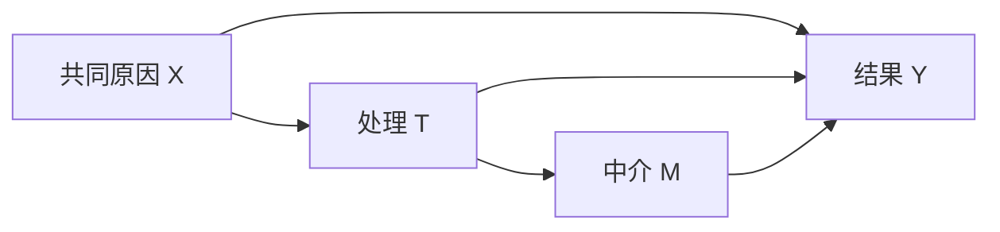

# 数据与回归技能组合

[English](README.md) | **中文**

本目录提供由代理编排的数据与技能组合，包含代码生成指令和经过测试的编排示例。可执行模块位于[回归技能](../../skills/model/shared/machine_learning_model/SKILL_ZH.md)，科学定义位于[方法库](../../methods/shared/machine_learning_model/README_ZH.md)，具体研究问题和实验位于[编号项目](../../projects/README_ZH.md)。`workflow.yaml` 是组合说明，不是通用执行引擎。

新研究先采用[计划→审核→生成→执行](planning_ZH.md)，使用[计划调用程序](examples/planned_regression.py)。默认人工审核，代理判断须有用户明确委托。下面的固定合成程序保留作既有技术重放，不能证明完成新的科学方案审核。

## 组合设计

依据技能的[操作契约](../../skills/model/shared/machine_learning_model/references/operations_ZH.md)配置和调用。空气污染任务同时采用[领域方法](../../methods/shared/air_pollution_regression_ZH.md)及[操作特例](../../skills/model/shared/machine_learning_model/references/air-pollution_ZH.md)。可复用数值运算保留在技能，生成的工作流代码提供任务设置与编排。

1. **选数据并定义目标。** 将未观测时空区域的预测目标与实测或代理训练标签分别定义，固定输入版本、单位、平均时期及预测时点信息。核对特征来源、同化、融合、校准及评估观测重用，按方法检查独立性和可获得性。数据准备须符合任务契约。
2. **明确解释问题。** 选择预测关联或特定因果效应。因果问题先定义处理、结果、剂量尺度和估计目标，再选择控制变量。
3. **设计 DAG。** 定义物理量和代理量，以机制、证据及时间顺序论证方向，考虑备选图、测量与产品生成依赖。区分共同原因、中介、碰撞点及未测因素，按估计目标选择调整与敏感性检查。程序检查无环性和支持的后门条件，不判断图是否真实。
4. **选择操作分支。** 预测组合训练集内筛选、回归、验证选型、冻结评估和预测解释；因果 PLR 组合显式调整集、折内辅助回归及残差得分估计。不用预测重要性选择调整集。
5. **检查交接。** 按可用数据及独立时空单元选择研究专用划分，单独配置计算上限。核对样本键、变量角色、单位、已拟合变换、边界和产物。记录未知产品依赖，执行器不核实上游来源；无标签区域推理与导出仍需适配。操作检查失败时停止后续计算。
6. **保存与复核。** 合成工作流检查使用本工作流被忽略的结果目录；其他通用演示使用所属技能被忽略的本地结果目录；项目使用外部项目根，内部目录和文件名由任务配置。复用前进行科学复核。

## DAG 示例

下图概括[正式发表文章](https://doi.org/10.1016/j.atmosres.2026.108869)图 2 中的设计思路，不是自动发现的因果图。



估计总效应时，`X` 可用于阻断后门路径，而 `M` 是处理后代。直接效应、其他图或观测数据调整集需要相应科学设计。预测示例不会启动因果估计。

## 两个组合示例

| 组合 | 数据 | 配置 | 用途 |
|---|---|---|---|
| 站点臭氧预测 | 外部 AQ-Bench v1 | [预测任务](../../config/examples/ml-regression/aq-bench-prediction.json)、[执行参数](../../config/examples/run-tool/aq-bench-ml-regression.json) | 演示目标设定、回归及预测解释 |
| 已知效应因果演示 | [合成示例](../../assets/data/03_atmospheric_transport/SyntheticCausal/v1/README_ZH.md) | [因果任务](../../config/examples/ml-regression/synthetic-causal.json)、[执行参数](../../config/examples/run-tool/synthetic-causal.json) | 检查声明的 DAG 和交叉拟合 PLR，已知斜率为 2 |

操作入口仍为已注册工具 `ml_regression_workflow`，依赖、预检、参数校验、输出命名和 MCP 授权见技能说明。该名称保留为入口标识，代码不再依赖执行本目录的 YAML。

[研究项目 0001](../../projects/0001_ozone_environmental_drivers/README_ZH.md)单独规定科学比较，通用检查不代表这些实验已完成。当前没有通用多实验编排、自动因果发现、科学审批或自动数据入库。

## 给代理的指令示例

> 使用授权的输入版本和回归技能，以声明的特征预测配置的目标。先检查单位、样本键、划分标签及预测时点是否可获得特征。采用小规模示例预算，通过 `ml_regression_workflow` 预检后拟合、评估并解释。合成工作流检查保存在本工作流被忽略的结果目录，其他通用演示保存在技能结果目录；具体研究使用稳定项目编号，在该项目结果根内自选目录。汇报产物索引、指标与检查。若需因果解释，先提出处理、结果、估计目标、DAG 和调整假设供科学复核，不根据特征重要性推导。

代理将要求转成已支持的设置和操作。该组合不执行自由文本，不任意选模型或授权额外数据访问。使用任务结构，遇到未支持要求时明确列出适配项。

## 将要求对应到已支持配置

[共享设计方法](../../methods/shared/requirements_driven_model_building_ZH.md)定义科学选择。本组合将其对应到已有任务结构，不增加另一套请求加载器。

| 要求 | 现有任务设置或交接 | 边界 |
|---|---|---|
| 预测数值响应 | `target`、`target_unit`、`target_definition` | 汇总、单位换算与时间对齐需明确准备 |
| 使用或筛选特征 | `features`、`excluded_features`、`feature_selection` | 筛选只用训练数据，因果调整仍由人工确定 |
| 选择回归模型 | 技能支持的有界 `models` 配置 | 其他学习器与自动调参需适配 |
| 设置开发与评估 | `id_column`、`split`、`row_limits`、`seeds` | 提供合法标签和适合研究的划分，不自动生成空间划分 |
| 解释拟合预测 | `explanation.methods` 及背景规模限制 | 使用已支持预测解释并说明范围 |
| 估计已支持因果效应 | `analysis: causal_plr` 与显式 `causal` 配置 | 先明确 DAG、调整集、辅助模型、折分和科学假设 |
| 保存结果 | 执行器项目与范围设置、任务 `output_files` | 在选定结果边界内保留来源，不覆盖既有产物 |

阅读数据契约，选择[预测](../../config/examples/ml-regression/aq-bench-prediction.json)或[合成因果](../../config/examples/ml-regression/synthetic-causal.json)设置，使用对应[执行器参数](../../config/examples/run-tool/aq-bench-ml-regression.json)。先预检，再按授权预算执行，随后检查产物索引、样本键、冻结模型指标和解释。准备、拟合、评估和解释是一个注册技能入口的内部模块，不是独立工具编号或自动执行的 YAML 链。

每次交接前检查字段角色、单位、样本与划分身份、已拟合变换及预期产物。前置条件失败时停止后续操作。具体实验及比较结果归项目；[臭氧项目参考](../../projects/0001_ozone_environmental_drivers/references/air_quality_o3_reference_ZH.md)记录旧案例，不将其设为默认算法或已完成的项目实验。

AQ-Bench 也提供[已登记的仓库副本](../../assets/data/03_atmospheric_transport/AQ-Bench/v1/README_ZH.md)。可使用[仓库参数](../../config/examples/run-tool/aq-bench-repository.json)或原外部输入参数，两处 CSV 哈希一致；选择副本不改变模型设置或结果边界。

## 从提示词到经过检查的代码

先阅读[注意事项](checklist_ZH.md)，使用[代码生成提示词](prompt_ZH.md)，再检查[代理编写的代码示例](examples/generated_regression.py)。示例通过执行器调用已有技能，数值算法继续保留在技能中。宿主代理根据要求生成代码；目前没有自动大模型接口、任意代码执行器或 YAML 执行引擎。同一提示词可能生成不同程序，因此需要保留实际生成代码。

```text
用户要求 + 数据契约 + 科学方法
  → 提示词 → 代理生成任务配置与编排代码
  → 代码审查 → 语法检查 → 预检 → 合成执行
  → 独立核验 → 保留代码、配置和结果 → 审查后复用
```

在仓库根目录，按技能说明显式设置既有的三个分离存储根和 R 包库。不加载凭据或个人启动文件。示例仅使用登记的合成 CSV，保留全部 400/100/100 条样本，比较均值基线、决策树及 48 棵树的森林，完成验证集选型、留出评分、模型重载、置换/PDP/ICE 和独立 Python 指标核验。

```sh
python workflows/ml_regression/examples/generated_regression.py
python workflows/ml_regression/examples/generated_regression.py --execute
```

400/100/100 仅属于本固定合成检查；新任务按实际可用数据和研究设计确定划分成员，再单独设置 `row_limits` 计算上限。

第一条只做预检，应检查 `can_execute` 和 `blockers`；第二条运行有界检查并显示新编号。通过 `workflows/ml_regression/results/<timestamp>_<task>/artifacts.json`、`verification.json` 和 `delivery-sha256.json` 查看模型产物、检查及哈希。本地结果及 `.airmosaic/` 回执被 Git 忽略，不覆盖既有运行。可共享且经审查的证据保存在忽略目录外的[示例说明](examples/README_ZH.md)。真实项目结果继续保存在外部。

[论文专用预测代码](../../projects/0001_ozone_environmental_drivers/prediction_ZH.md)现已平放在项目目录中。其国家/气候规则和十折协议不作为合成工作流的默认设置。原来额外的实验目录已移除，历史结果快照保持原样。


遵循[统一执行与过程记录规范](../../harness/usage/workflow-handoff_ZH.md)。新运行使用12 位年月日时分加公开任务名，内部运行编号仅关联回执。保存 gen_script/、events.jsonl、retrospective.md / retrospective_ZH.md 和总体 workflow.json；不新增 source_snapshot/，仅在明确授权后清理已核对的冗余合成批次。生成依据是显式设计摘要，不冒充未捕获的历史生成会话。
